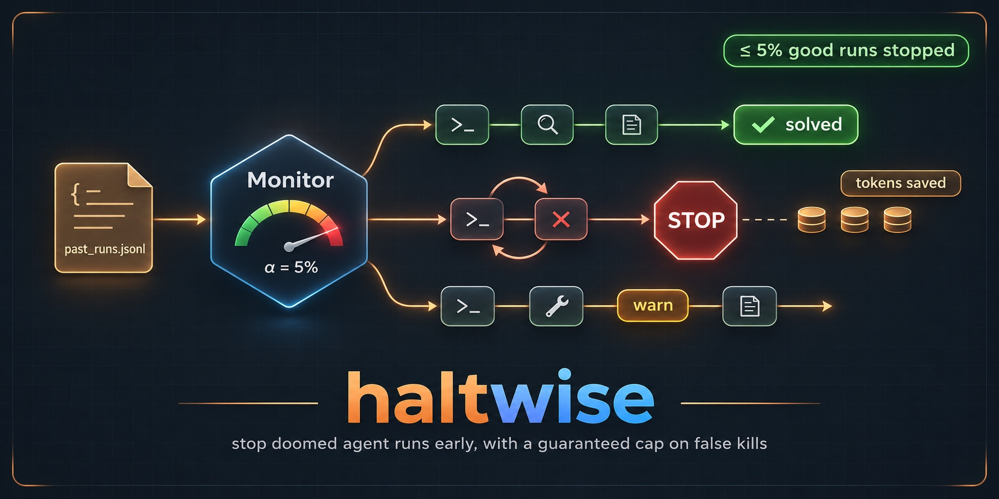
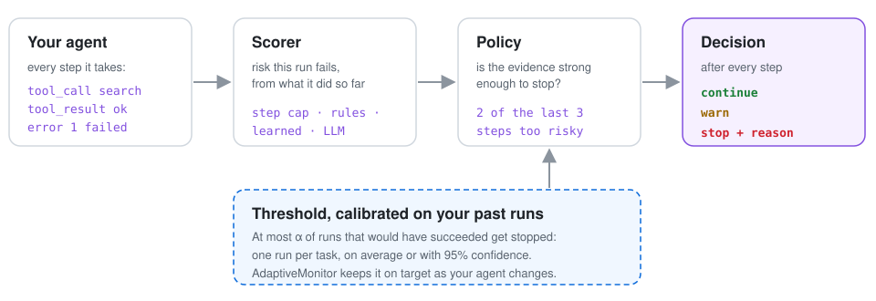

<p align="center">
  
</p>

<p align="center">
  <b>Stop doomed LLM-agent runs early, with a guaranteed cap on how many good runs you kill.</b><br>
  haltwise watches what your agent does, step by step, and tells you when a run<br>
  is going nowhere. You choose the price: "stop at most 5% of runs that would have succeeded."
</p>

<p align="center">
  <a href="https://pypi.org/project/haltwise/"></a>
  <a href="https://pypi.org/project/haltwise/"></a>
  
  
  <a href="https://github.com/aswin-kevin/haltwise/actions/workflows/ci.yml"></a>
  <a href="https://github.com/aswin-kevin/haltwise/blob/main/LICENSE"></a>
</p>

<p align="center">
  <a href="https://github.com/aswin-kevin/haltwise#quickstart">Quickstart</a> ·
  <a href="https://github.com/aswin-kevin/haltwise#guard-a-live-agent">Guard a live agent</a> ·
  <a href="https://github.com/aswin-kevin/haltwise#does-it-actually-work">Does it work?</a> ·
  <a href="https://github.com/aswin-kevin/haltwise#faq">FAQ</a>
</p>

haltwise is **not** an agent framework, and it doesn't call any model. It sits beside
the agent you already run (OpenAI or Anthropic SDK, LangGraph, your own loop...) and
reads only what the agent *does*: tool calls, results, errors. So it works with any
model, needs no GPU, and never sees your prompts unless you hand them over.

```sh
pip install haltwise      # Python 3.10+, depends only on numpy
```

## The problem

Every agent loop ends up with a guess like this:

```python
for turn in range(50):  # why 50? too low cuts off good runs, too high pays for bad ones
    action = agent.step()
    if action.is_final:
        break
```

Agents loop, retry the same failing command, and burn tokens on runs that are already
lost. A step limit is a blunt instrument, and hand-written loop detectors are rules
nobody has checked against real outcomes.

haltwise learns from your past runs when to stop, and **calibrates** that decision
so the share of good runs you stop is capped at a number you choose.

## Concepts in 30 seconds

| Term | What it is |
| --- | --- |
| **Step** | One thing your agent did: a model call, a tool call, a tool result, an error. |
| **Run** | A whole attempt at a task, and, for past runs, whether it succeeded. |
| **Scorer** | Turns the run so far into a risk of failure: a step count, rules, a learned model, or an LLM. |
| **Policy** | Decides when the risk is convincing enough to stop, e.g. "2 of the last 3 steps". |
| **false_kill_rate** | The share of runs that *would have succeeded* that you accept stopping. Calibration enforces it. |
| **Monitor** / **Watch** | The calibrated decision-maker, and its per-run guard that you feed steps. |

## How it works

<p align="center">
  
</p>

After every step, a **scorer** estimates how likely the run is to fail, and a **policy**
compares the recent risks with a threshold. The threshold is **calibrated on your past
runs**, so at most the share of good runs you chose gets stopped.

## Quickstart

```python
from haltwise import Monitor, calibrate_step_cap, split_runs
from haltwise.synthetic import make_runs  # stand-in for your own logged runs

past, new = split_runs(make_runs(2000, seed=0), test_share=0.3)

# 1. A max_steps you can defend: cuts off at most 5% of runs that would have succeeded.
print("max_steps =", calibrate_step_cap(past, false_kill_rate=0.05))

# 2. A monitor that learns what doomed runs look like, with the same guarantee.
monitor = Monitor(false_kill_rate=0.05).fit(past)
report = monitor.evaluate(new)  # always check on runs it hasn't seen
print(f"good runs stopped: {report.task_false_kill_rate:.1%} (target 5%)")
print(f"failed-run steps saved: {report.steps_saved:.1%}")
```

```text
max_steps = 42
good runs stopped: 3.4% (target 5%)
failed-run steps saved: 43.9%
```

That's synthetic data, which is deliberately easy. On real agents the savings are
smaller; see [Does it actually work?](https://github.com/aswin-kevin/haltwise#does-it-actually-work).

## Guard a live agent

Describe each step as it happens and ask haltwise what to do:

```python
from haltwise import Step

watch = monitor.watch()  # one watch per run
for turn in range(1, 51):
    for step in agent_turn(turn):  # e.g. Step.tool_call("run_tests", {"path": "tests/"})
        decision = watch.observe(step)
    print(f"turn {turn}: {decision.action.value}")
    if decision.should_stop:
        print(decision.reason)
        break
```

With an agent that does 5 useful turns and then gets stuck re-running a failing test:

```text
turn 1: continue
turn 2: continue
turn 3: continue
turn 4: continue
turn 5: continue
turn 6: continue
turn 7: stop
risk 1.00: 2 of the last 3 steps were above the stopping threshold 0.62
```

Healthy work is left alone; one turn after the loop starts, it stops.

**Describing steps.** Use `Step.llm()`, `Step.tool_call(name, args)`,
`Step.tool_result(name)` and `Step.error(text)`. Tool arguments are fingerprinted, not
stored, so haltwise can spot an agent repeating itself without keeping your data. For
past runs, wrap the steps in `Run(steps, succeeded=..., task=...)`, and save them with
`save_runs` / `load_runs` (JSON Lines).

**Already emitting OpenTelemetry?** If your agent produces GenAI spans (`execute_tool`,
`chat`...), haltwise reads them directly, with no OpenTelemetry dependency:

```python
from haltwise.adapters.otel import HaltwiseSpanProcessor, spans_to_runs

runs = spans_to_runs(exported_spans, outcomes={trace_id: succeeded})  # learn from history
provider.add_span_processor(HaltwiseSpanProcessor(monitor, on_stop=cancel))  # guard live runs
```

**When your agent changes,** use `AdaptiveMonitor`. A new model, prompt or tool shifts
how runs look, and a fixed threshold drifts off target. `AdaptiveMonitor` keeps
correcting it from the outcomes of finished runs:

```python
from haltwise import AdaptiveMonitor

adaptive = AdaptiveMonitor(monitor)
watch = adaptive.watch()
...  # guard the run as above
adaptive.record(watch, succeeded=run_passed)  # None if unknown
```

## Why haltwise

- 🎯 **A guarantee, not a guess.** Pick a false-kill rate; split-conformal calibration
  enforces it on runs from new tasks, on average or `confidence=0.95` for your exact
  threshold.
- 🧩 **Task-aware.** Repeated attempts at one task are near-copies; haltwise calibrates
  and evaluates per task, so one hard task can't fake the evidence.
- 🔄 **Stays calibrated as you ship.** `AdaptiveMonitor` tracks the target under drift,
  and handles the catch that stopped runs never reveal their outcome (shadow runs).
- 🔍 **Explains itself.** Every decision says why: *"2 of the last 3 steps were above the
  stopping threshold."*
- 🧪 **Honest by design.** `benchmarks/audit.py` compares every scorer against a calibrated
  step cap, using leak-free metrics, and `simulate_budget` replays stop / restart / continue
  on your own logs before you automate anything.
- 🪶 **Light and typed.** Pure Python plus numpy, strict type hints, no GPU, no service,
  no model calls (unless you opt into `SelfReportScorer`).
- 🔌 **Any agent.** Plain `Step` objects, JSON Lines, or OpenTelemetry GenAI spans.

## Does it actually work?

We measured it on two public agent datasets and a live agent, and wrote down the
results that weren't flattering too.

**Replayed runs.** Every monitor was calibrated to a 5% target on the same tasks and
tested on held-out tasks (means of 5 splits):

| Steps saved on failed runs | nebius SWE-agent (llama, 40k runs) | SWE-smith (Claude / GPT-4o, 6k runs) |
| --- | :---: | :---: |
| calibrated step cap | 15.2% | 10.4% |
| `RuleScorer` | 19.2% | 4.1% |
| `FeatureScorer` (default) | **21.5%** | **12.2%** |

The guarantee held on both datasets. A plain calibrated step cap gets most of the
savings; the learned scorer adds about 6 points on the weaker agent and about 2 on the
stronger ones.

**When the agent changes.** A monitor calibrated on llama-70b, then reused on llama-8b,
stopped **16.7%** of good runs against a 5% target. `AdaptiveMonitor` brought it back to
**4.3%** (mean of 20 random orders).

**A live agent.** A tool-using agent on Ollama Cloud, with real token counts, about 800
live runs:

- **The guarantee held live:** 0 of 241 successful attempts would have been stopped.
- **Savings were modest:** 7–13% of the tokens spent on failed attempts, for an agent
  running out of turns.
- **With room to spare, there was nothing to save:** the agent solved 97% and haltwise
  had nothing to do.
- **Restarting didn't solve more tasks,** cold or with a hint about what went wrong (a
  pre-registered confirmation on 100 tasks: +2.0 points, 95% interval −4 to +8).

**In short:** haltwise is a cheap, safe brake that trims wasted tokens on agents that
get stuck, with a guarantee you can trust. It won't make your agent solve more tasks.
Every number above can be reproduced with
[`benchmarks/`](https://github.com/aswin-kevin/haltwise/tree/main/benchmarks) and
[`trials/`](https://github.com/aswin-kevin/haltwise/tree/main/trials/ollama_agent).

## How it compares

| | haltwise | `max_steps` / timeout | hand-written loop detector | observability platform |
| --- | :---: | :---: | :---: | :---: |
| Stops a run while it's running | ✅ | ✅ | ✅ | ❌ after the fact |
| Learns from your past outcomes | ✅ | ❌ | ❌ | ❌ |
| Cap on good runs stopped | ✅ calibrated | ❌ | ❌ | n/a |
| Stays calibrated when the agent changes | ✅ | ❌ | ❌ | n/a |
| Tells you whether it's worth it | ✅ audit + simulator | ❌ | ❌ | ❌ |

## FAQ

**Does it predict which runs will fail?** Partly, and mostly late in a run. Early
signals are weak: comparing attempts on the *same* task, accuracy is close to a coin
flip for the first ~10 steps (as found in arXiv 2610.35971). That's why haltwise leads
with a calibrated brake and a guarantee, not prediction claims.

**How many past runs do I need?** For a 5% target, at least 19 tasks with a successful
run; about 100 for a steady threshold; 59 with `confidence=0.95`. The learned scorer
needs more, because it must train *and* calibrate. Start with `calibrate_step_cap`.

**Does it call an LLM or send my data anywhere?** No. Only `SelfReportScorer` asks a
model, and only if you use it. In our tests it added no early signal.

**Will it work with LangGraph, the OpenAI Agents SDK, ...?** Yes: create a `Step` per
event in your loop or callback, or export OpenTelemetry GenAI spans.

**Is it production-ready?** It's 0.1 (alpha): strictly typed, 300+ tests, CI on Python
3.10–3.13 for Linux and macOS, but the API may change before 1.0.

## Learn more

- 📊 **[Benchmarks](https://github.com/aswin-kevin/haltwise/tree/main/benchmarks)**: the audit, drift, budget-simulator and second-dataset scripts.
- 🤖 **[Live trial](https://github.com/aswin-kevin/haltwise/tree/main/trials/ollama_agent)**: the safe Ollama agent harness (read-only tools, no code execution).
- 🧪 **[Examples](https://github.com/aswin-kevin/haltwise/tree/main/examples)**: quickstart and OpenTelemetry.
- 📝 **[Changelog](https://github.com/aswin-kevin/haltwise/blob/main/CHANGELOG.md)**

## Built on

haltwise packages ideas from recent research; it doesn't claim them:

- **Failure monitors that score every prefix:** PrefixGuard (arXiv 2605.06455),
  StopLoss (2610.25525), Fail-Fast/Restart-Smart (2608.03222).
- **Conformal early stopping:** StopLoss and Statistical Early Stopping for Reasoning
  Models (2602.13935).
- **Stopping when warnings repeat, not on the first one:** OnTrack (2610.12375).
- **Online conformal calibration:** adaptive conformal inference (Gibbs & Candès, 2021)
  and conformal PID control (Angelopoulos, Candès & Tibshirani, 2023).
- **One sample per group for hierarchical data:** Dunn, Wasserman & Ramdas (2022).
- **Honest baselines for early failure prediction:** *Continue or Restart?* (2610.35971).

What haltwise adds:

- a framework-independent runtime;
- task-aware calibration and reporting;
- censoring-aware online recalibration using shadow runs;
- one API for comparing scorers, plus a budget simulator.

## License

[Apache-2.0](https://github.com/aswin-kevin/haltwise/blob/main/LICENSE)
